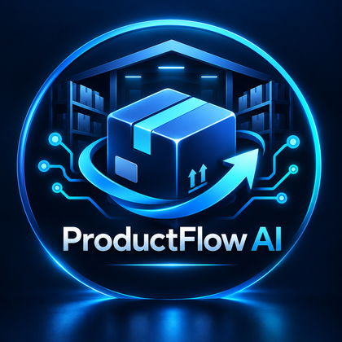
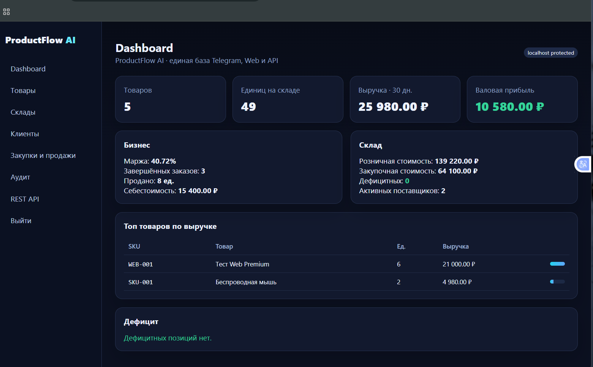
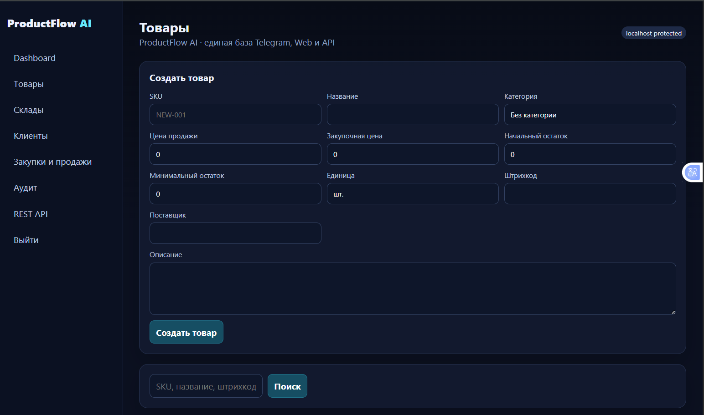
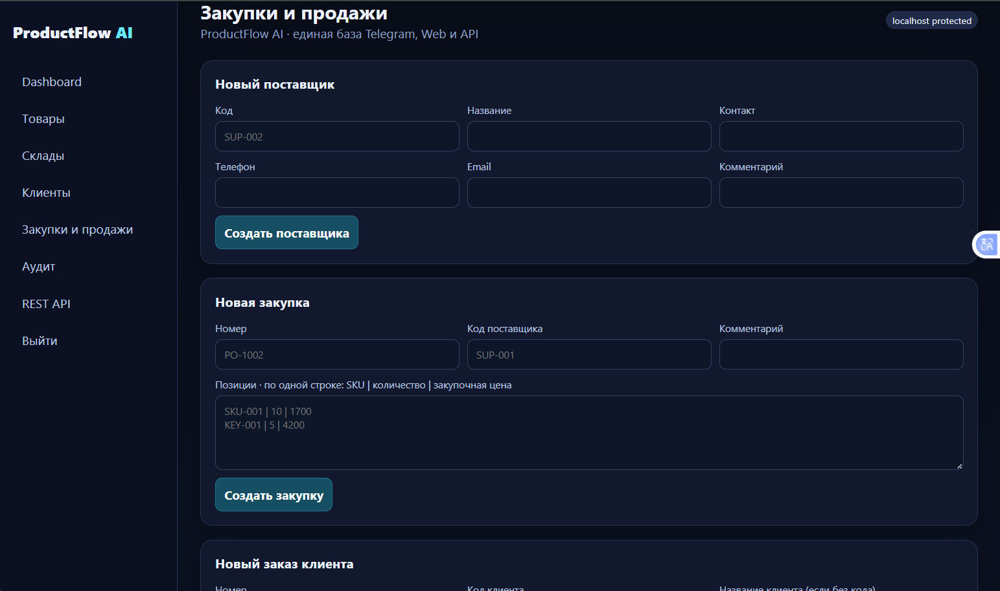
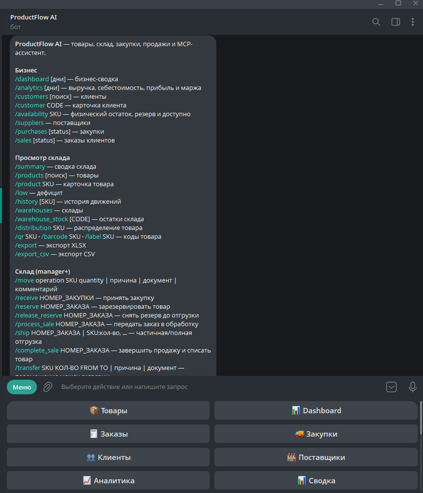
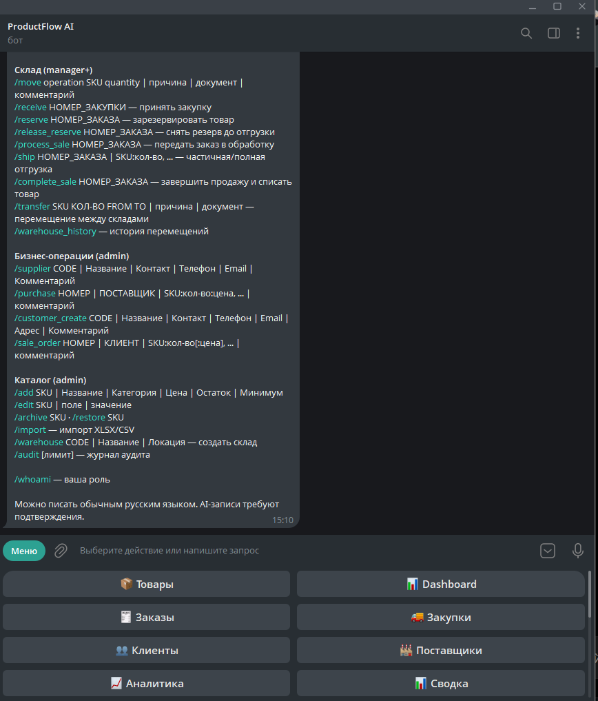

<p align="center">
  
</p>

<h1 align="center">ProductFlow AI</h1>

<p align="center">
  <b>AI-powered inventory, warehouse, CRM and order-management platform built around MCP.</b><br>
  Telegram Bot · Web Admin · REST API · SQLite · Multi-warehouse · CRM · Reservations · Audit
</p>

---

## О проекте

**ProductFlow AI v1.7.0** — production-ready система управления товарами, складами, закупками, продажами и клиентами.  
В проекте одна бизнес-база и несколько интерфейсов: **Telegram**, **Web Admin**, **REST API** и **MCP tools** для AI-агента.

Главная идея: AI не работает с базой напрямую. Все операции проходят через контролируемый MCP-слой с бизнес-правилами, ролями, подтверждением изменяющих действий и аудитом.

## Возможности

- каталог товаров: SKU, категория, цена продажи, закупочная цена, поставщик, штрихкод, единица измерения;
- складские операции: приход, продажа, возврат, списание, корректировка;
- контроль отрицательных остатков и дефицита;
- **мультисклад**: MAIN + дополнительные склады, распределение и перемещения;
- поставщики и закупочные заказы;
- клиентские заказы, выручка, себестоимость, валовая прибыль и маржа;
- **CRM клиентов/контрагентов** и история заказов;
- **резервирование товара** без уменьшения физического остатка;
- workflow заказа: `new → reserved → processing → completed`;
- частичная отгрузка и защита резервов;
- QR-коды, Code128 и товарные этикетки;
- Excel/CSV импорт и экспорт;
- роли `admin / manager / viewer`;
- подтверждение всех AI write-операций;
- audit trail для Telegram, AI, Web и REST API;
- автоматические уведомления о дефиците и ежедневный бизнес-отчёт;
- systemd 24/7, health-check и автоматический SQLite backup;
- Web Admin и REST API, закрытые по умолчанию на `127.0.0.1`.

## Интерфейсы

### Web Admin

<p align="center">
  
</p>

Dashboard объединяет склад, продажи и финансовую аналитику в одном интерфейсе.

<p align="center">
  
</p>

Из Web можно создавать и редактировать товары, управлять остатками, поставщиками, закупками, продажами, клиентами и складами.

<p align="center">
  
</p>

Проведённые документы защищены от ретроспективного изменения: `received`-закупки и `completed`-продажи становятся неизменяемыми.

### Telegram AI Assistant

<p align="center">
  
  
</p>

Бот поддерживает команды и запросы обычным русским языком. AI использует MCP tools, а любые изменяющие действия требуют подтверждения пользователя.

Примеры запросов:

```text
Сколько мы заработали за последние 30 дней?
Покажи распределение SKU-001 по складам.
Какие товары дали больше всего выручки?
Создай закупку у поставщика.
Зарезервируй заказ клиента.
```

## Архитектура

```text
                        ┌──────────────────┐
                        │   Telegram Bot   │
                        │  AI + commands   │
                        └────────┬─────────┘
                                 │
                                 ▼
┌──────────────┐          ┌───────────────┐          ┌──────────────┐
│  Web Admin   │─────────▶│ Business Core │◀─────────│   REST API   │
└──────────────┘          │ + MCP tools   │          └──────────────┘
                          └───────┬───────┘
                                  │
                                  ▼
                          ┌───────────────┐
                          │    SQLite     │
                          │ products.sqlite3
                          └───────────────┘
```

MCP является контролируемым интерфейсом между AI и бизнес-данными. Web/REST используют те же правила и ту же SQLite-базу, поэтому состояние синхронно во всех интерфейсах.

## MCP

В v1.7.0 доступно **39 MCP tools**. Основные группы:

- товары и остатки;
- история движений и дефицит;
- поставщики и закупки;
- продажи и аналитика;
- мультисклад;
- аудит;
- CRM клиентов;
- доступность товара;
- резерв, обработка и частичная отгрузка заказов.

## CRM и резервирование

Резерв не уменьшает физический остаток, но уменьшает доступное к продаже количество:

```text
Физически:  13
В резерве:   4
Доступно:     9
```

При частичной отгрузке одновременно уменьшаются физический остаток и резерв. Защита резервов действует также на ручные складские списания и межскладские перемещения.

## REST API

Основные endpoints:

```text
GET    /api/v1/dashboard
GET    /api/v1/products
GET    /api/v1/products/{sku}
GET    /api/v1/warehouses
GET    /api/v1/customers
GET    /api/v1/customers/{code}
GET    /api/v1/availability/{sku}

POST   /api/v1/products
POST   /api/v1/stock/operation
POST   /api/v1/transfers
POST   /api/v1/purchases
POST   /api/v1/sales
POST   /api/v1/sales/{order_no}/reserve
POST   /api/v1/sales/{order_no}/processing
POST   /api/v1/sales/{order_no}/ship
```

REST write-операции фиксируются в журнале аудита. Доступ защищён Bearer API key.

## Безопасность

- `.env`, SQLite, backups и Web credentials исключены из Git;
- Web Admin по умолчанию слушает только `127.0.0.1:8090`;
- для удалённого доступа рекомендуется SSH tunnel или TLS reverse proxy;
- AI write-tools требуют подтверждения;
- роли ограничивают доступ к операциям;
- audit trail хранит источник, роль, действие и результат;
- rate limit защищает Telegram-интерфейс от частых запросов.

## Быстрый старт

### Windows / локальная разработка

```powershell
py -m venv .venv
.\.venv\Scripts\Activate.ps1
pip install -r requirements.txt
Copy-Item .env.example .env
```

Заполните `.env`, затем:

```powershell
python -m scripts.check_cloud_ru
python -m scripts.check_telegram
python -m scripts.smoke_test_mcp
python -m telegram_bot.main
```

### VPS / Linux

Подробная инструкция: [`DEPLOY_V170.md`](DEPLOY_V170.md).

Для существующей установки:

```bash
bash deploy/update_server.sh /opt/productflow-ai
```

Скрипт делает safety backup `.env` и `data`, запускает миграции, тесты и systemd-сервисы.

### Web Admin

По умолчанию:

```env
WEB_HOST=127.0.0.1
WEB_PORT=8090
```

Безопасный SSH tunnel:

```bash
ssh -L 8090:127.0.0.1:8090 root@YOUR_SERVER_IP
```

После этого Web Admin доступен локально на `http://127.0.0.1:8090`.

## Конфигурация AI

Пример OpenAI-compatible endpoint:

```env
OPENAI_BASE_URL=https://foundation-models.api.cloud.ru/v1
OPENAI_MODEL=deepseek-ai/DeepSeek-V4-Pro
OPENAI_API_KEY=
```

Проект не содержит реальных токенов, API keys или production database.

## Тесты

В релизе v1.7.0 — **48 автоматических тестов**.

```bash
python -m pytest -ra
python -m scripts.healthcheck
python -m scripts.smoke_test_mcp
python -m scripts.smoke_test_web
```

Проверяются в том числе:

- запрет отрицательных остатков;
- атомарность продаж;
- миграции старых версий;
- Web authentication;
- REST API;
- мультисклад;
- аудит;
- CRM;
- резервирование;
- защита резерва;
- частичная отгрузка.

## Структура проекта

```text
product-mcp/
├── mcp_server/        # DB, repositories, MCP tools, commerce, CRM, warehouses
├── telegram_bot/      # aiogram, AI agent, MCP client, notifications, exports
├── web_admin/         # Web Admin + REST API
├── scripts/           # checks, smoke tests, backup
├── tests/             # automated tests
├── deploy/            # systemd/update scripts
├── docs/images/       # screenshots and branding
├── .env.example
├── requirements.txt
└── README.md
```

## Версия

**ProductFlow AI v1.7.0**

Проект развивается итеративно: от базового MCP-склада до единой AI/Telegram/Web/REST платформы с CRM и order workflow.
